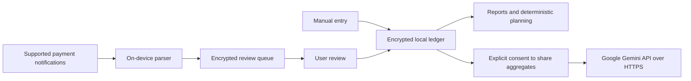

# Moneywise — project report and implementation brief

## Product
Moneywise is an Android personal-finance companion for a person who wants to understand spending, save for future goals, and receive practical coaching. The initial market assumption is India, INR, English, Android 7/API 24 or later. The visual identity uses emerald green, warm neutral surfaces, an M-shaped growth mark, large amounts and plain labels. The name is a working product name; trademark/store-name availability has not been checked.

## User experience
Four tabs keep the interface simple:

1. **Home:** estimated safe-to-spend, income/expenses, tracked balance, category chart, recent activity and capture inbox.
2. **Activity:** month navigation, search, income/expense/transfer filters, expandable monthly category reports and previous-month expenses. Entries can be created, edited and deleted. Categories are editable per entry, and users can create custom categories.
3. **Plan:** monthly budgets, reserved bills, planned savings, savings goals with target dates, emergency-fund goals, recurring bill/subscription dates, a basic cash-flow scenario, savings what-if calculator and debt payoff calculator.
4. **Coach:** deterministic local spending insights plus optional Gemini coaching called directly from the phone.

Settings provide notification-access controls, Gemini API-key/model configuration, explicit backup export/restore and deletion. Start with an empty ledger; do not present fabricated transactions as the user's finances. Set an opening balance under Plan; it changes available funds without appearing as income. The tracked balance is not a live bank balance.

## Calculations and boundaries
Amounts are stored as integer paise; decimal text is parsed exactly. Transfers between owned accounts are excluded from both income and expenses. Reports use local calendar months. Safe-to-spend = opening balance + all-time recorded income − all-time recorded expenses − reserved upcoming bills − planned savings. A negative result is shown without clamping. Bill reserves and goal progress do not themselves move money or create expenses; users record actual payments separately.

Monthly goal contributions divide remaining target by remaining calendar months, rounded up; overdue goals use one month. The savings scenario assumes no investment return. The debt calculator models fixed monthly interest and payments, stops when the balance is repaid, and rejects payments that cannot cover interest. The forecast repeats current-month recorded income and expense totals and is explicitly an estimate; incomplete months can be misleading.

## Notification capture
An optional native Android NotificationListenerService filters an explicit list of payment/bank application package names. It parses INR amounts and clear debit/credit language, rejects failed/reversed/OTP/request alerts, and stores candidates in an AES-GCM Android-Keystore-encrypted queue. It does not request SMS permissions, banking passwords, OTPs or permission to make payments.

The user reviews a candidate, amount, transaction direction and suggested category before import. Source IDs prevent the same candidate from importing twice. Cross-application alerts may represent the same payment and require user review; perfect semantic duplicate matching is not claimed. Manual entries cover cash, unsupported formats and missing notifications. Captures are limited to 250 pending candidates and 2,000 recent event hashes; at capacity new candidates are ignored, so users must review the inbox regularly. Revoking notification access stops new capture. No historical bank sync is provided.

## Architecture
- Flutter/Dart Material 3 UI and domain logic, separate encrypted persistence and coaching client.
- Android Kotlin method channel for permissions and durable candidate queue.
- Encrypted device ledger using flutter_secure_storage; Android backup disabled. Screenshots/recents capture blocked by FLAG_SECURE on Android.
- No hosted server or backend. The Flutter HTTP client calls a fixed Google Gemini HTTPS endpoint directly. A personal Gemini key and model are configured in the app and stored encrypted on the phone; keys are excluded from ledger backups and source code.
- AI requests send category totals, budgets, goal names and a question after confirmation. Merchant names, notification bodies and account identifiers are excluded. Goal names/questions can still contain personal information; users must avoid sensitive text.
- Versioned JSON backups require explicit plaintext clipboard export consent and validated replace confirmation on restore.

## AI behavior
Local insights work without a network or key. Online coaching sends a request directly from the phone to Gemini only after user confirmation. It explains known figures, acknowledges incomplete data, and suggests up to three practical actions. It cannot move money. Notifications and transaction saves do not depend on AI responses or hosting uptime. Model failures, invalid keys, quota errors, safety refusals and timeouts produce useful errors while offline features remain available.

The user enters their own key under Settings → Gemini API settings, can select an available Gemini model, and can replace/remove the key. The default model is configurable because availability differs by Google project and can change. Keys are not hard-coded, included in the repository, or exported with the ledger. Direct personal-key access is appropriate for the owner's private installation; public distribution with a shared paid key needs a different credential design. Model output remains advice to review, not guaranteed financial improvement.

## Acceptance checks
- Correct paise parsing, debit/credit/transfer totals, month filtering and negative balances.
- Transaction CRUD survives restart; failed storage writes do not silently reset the ledger.
- Stable-source deduplication, conservative notification parsing, permission revocation and candidate review.
- Goals, budgets, reports, backup round trips and invalid-backup rejection.
- Direct Google-only HTTPS routing, aggregate-only requests, API-key header placement, invalid-key/quota responses, empty answers and timeout handling.
- Widget flows, Android compilation and physical-device checks at small/large text settings.

## Release scope and follow-up work
The repository implements the functions described above; see VALIDATION.md for evidence of what actually ran. Features discussed as later possibilities include receipt OCR, official bank aggregation, multi-currency conversion, multiuser cloud sync, on-device generative AI and scheduled system reminder notifications. Recurring bills currently provide in-app due-date reminders. Debt planning is a calculator rather than a synced loan account. Forecasting is a transparent scenario rather than a predictive model. These limitations must remain visible in the product and release description.

## Release gates
Do not label this release production-ready until analysis/tests/build pass, a signed release is installed and exercised on real supported Android devices, notification formats are checked against consented real examples, backup/recovery is tested, and release signing and a real-key Gemini check are completed. Store declarations are an additional gate only if publishing later. No test suite can establish that software has zero hidden bugs.

## Data flow

## Stored records

| Record | Key fields | Accounting effect |
| --- | --- | --- |
| Transaction | ID, source ID, merchant, category, integer paise, local date, kind | Income adds; expense subtracts; transfer excluded |
| Budget | Category and monthly integer-paise limit | Comparison only |
| Savings goal | Name, target, manually recorded savings, deadline | Informational; no double counting |
| Recurring bill | ID, name, integer paise, monthly due day | In-app due-date reminder; no automatic expense |
| Commitments | Reserved bills and planned savings | Deducted from safe-to-spend estimate |
| Coaching settings | Personal Gemini API key and model name | Encrypted on phone; key excluded from exported ledger backups |

## Delivery artifacts
The Flutter and native Android source, lockfile, launcher icon, brand SVG, this brief, privacy/release guidance, automated checks and direct Gemini integration are versioned together. CI produces an evaluation APK only after checks pass. Production signing credentials stay outside Git. The owner enters the Gemini key on the phone. Production signing, physical-device acceptance and a real Gemini request remain release gates, not implied by a source push.

The version-one local ledger is limited to 10 million JSON characters so every valid ledger can be restored through the backup flow. Long-term high-volume use should migrate to a transactional database with a tested migration path before raising this limit.
